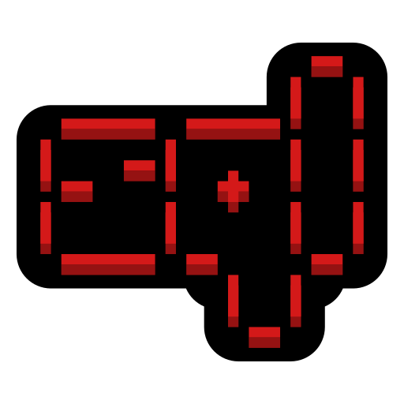
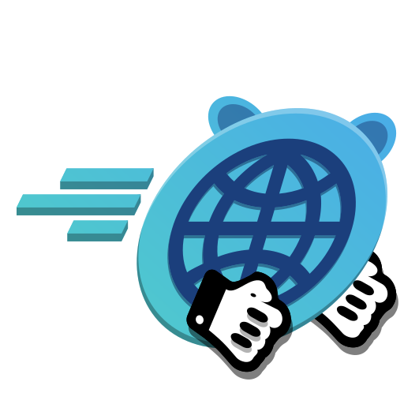
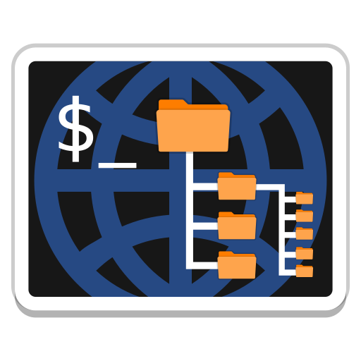
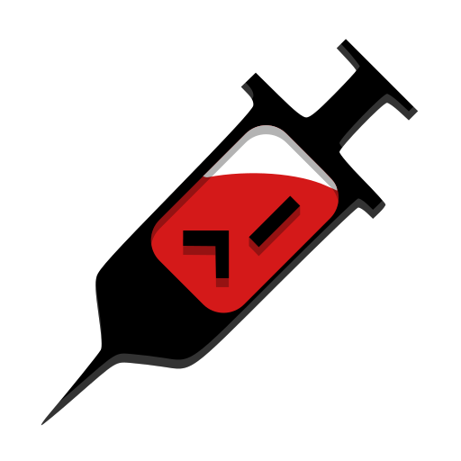
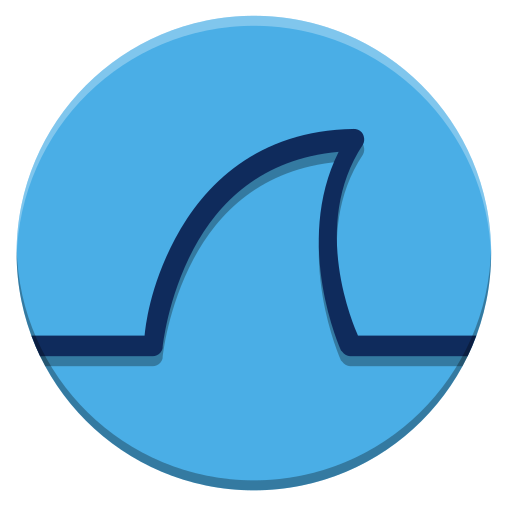
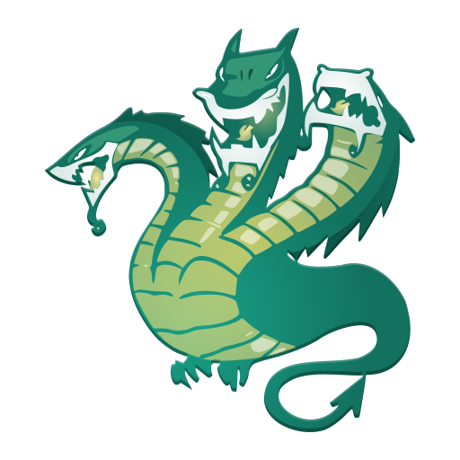

  

  

---

### 📌 About Me

- Hi, I'm **Hasib Hossain** — a **Cybersecurity & Web Security Specialist** and **Ethical Hacker** at **Etarnity Global Innovation** (Khulna, Bangladesh). I specialize in **web application penetration testing, OWASP Top 10 vulnerability assessment, SSL/TLS & API security auditing**, and **Kali Linux** reconnaissance & exploitation—alongside **Python & Bash** security automation and hardening **secure full-stack web systems** (PHP, JavaScript/TypeScript, React, Next.js, Node.js, Docker, Cloudflare). I focus on uncovering vulnerabilities before attackers do and building resilient digital infrastructure from code to deployment.

---

### 🧠 My Focus Areas & Current Activity

- 🛡️ **Web Application Security & Penetration Testing** — Discovering and remediating XSS, SQLi, CSRF, SSRF, and auth flaws using **Burp Suite, OWASP ZAP, SQLmap, Nikto, and ffuf**.
- 🔭 **Currently exploring** advanced **OWASP Top 10** exploitation & defense, API security testing, WAF evasion analysis, and **Zero-Trust web architectures**.
- 💻 **Currently working on** web security auditing, vulnerability assessments, and secure platform engineering at **Etarnity Global Innovation**.
- 🐧 **Kali Linux & Network Recon** — Automated scanning with **Nmap, Gobuster, SSLScan, Wireshark, Metasploit**, and custom **Python & Bash** tooling.
- 📫 **Reach out for security audits or collaborations:** [hasib.cyber.etarnity@gmail.com](mailto:hasib.cyber.etarnity@gmail.com)

---

### 📊 GitHub Stats & Activity

  
  

  

---

### 🛠️ Languages & Tools

<h4 align="center">Web Security, Recon &amp; AppSec Tools</h4>

  &nbsp;&nbsp;
  &nbsp;&nbsp;
  &nbsp;&nbsp;
  &nbsp;&nbsp;
  &nbsp;&nbsp;
  &nbsp;&nbsp;
  &nbsp;&nbsp;
  &nbsp;&nbsp;
  &nbsp;&nbsp;
  &nbsp;&nbsp;
  &nbsp;&nbsp;
  &nbsp;&nbsp;
  &nbsp;&nbsp;
  &nbsp;&nbsp;
  &nbsp;&nbsp;
  

<h4 align="center">Kali Linux, Network &amp; Exploitation Tools</h4>

  &nbsp;&nbsp;
  &nbsp;&nbsp;
  &nbsp;&nbsp;
  &nbsp;&nbsp;
  &nbsp;&nbsp;
  &nbsp;&nbsp;
  &nbsp;&nbsp;
  &nbsp;&nbsp;
  &nbsp;&nbsp;
  

<h4 align="center">Programming &amp; Scripting Languages</h4>

  &nbsp;&nbsp;
  &nbsp;&nbsp;
  &nbsp;&nbsp;
  &nbsp;&nbsp;
  &nbsp;&nbsp;
  &nbsp;&nbsp;
  

<h4 align="center">Web Stack &amp; Databases</h4>

  &nbsp;&nbsp;
  &nbsp;&nbsp;
  &nbsp;&nbsp;
  &nbsp;&nbsp;
  &nbsp;&nbsp;
  &nbsp;&nbsp;
  &nbsp;&nbsp;
  &nbsp;&nbsp;
  

<h4 align="center">OS, Infrastructure &amp; Dev Tools</h4>

  &nbsp;&nbsp;
  &nbsp;&nbsp;
  &nbsp;&nbsp;
  &nbsp;&nbsp;
  &nbsp;&nbsp;
  &nbsp;&nbsp;
  

---

### 🔗 Connect with Me

  &nbsp;&nbsp;&nbsp;&nbsp;&nbsp;&nbsp;&nbsp;&nbsp;&nbsp;&nbsp;

 

  <picture>
    <source media="(prefers-color-scheme: dark)" srcset="https://raw.githubusercontent.com/hasibcybersec/hasibcybersec/output/pacman-contribution-graph-dark.svg" />
    <source media="(prefers-color-scheme: light)" srcset="https://raw.githubusercontent.com/hasibcybersec/hasibcybersec/output/pacman-contribution-graph.svg" />
    
  </picture>

  

